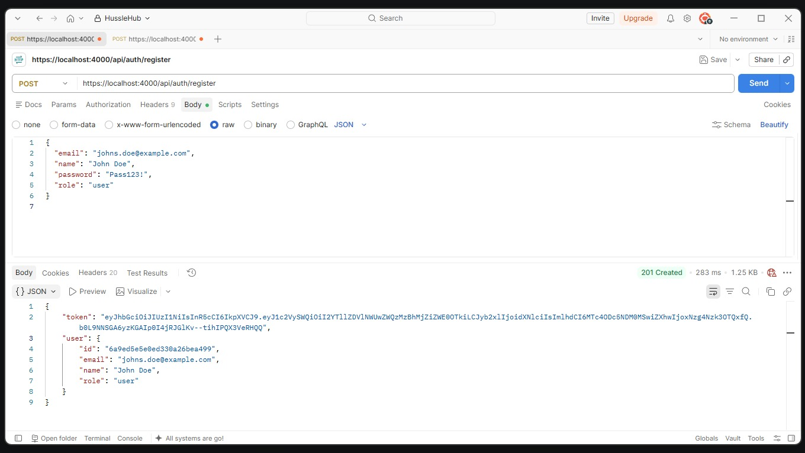
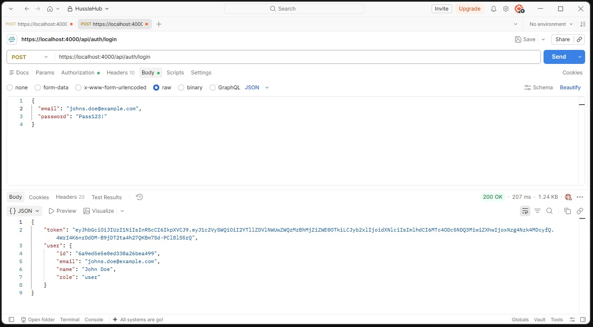

# 🚀 Application Setup & Usage

## 📋 Prerequisites

Before running the application, make sure you have **Node.js** and **npm** installed on your system.

You can verify your installation by running:

```bash
node --version
npm --version
```

Ensure that you have **mongodb installed** too.
Download and install it from [here](https://www.mongodb.com/products/self-managed/community-edition) if you don't already have it installed on your machine. 


Further please ensure you have a Mongodb running and have a connection setup and running. A Database "hustlehub" will be created and used to store data.

The Api Has a setup that allows the use of multiple .env files, the .env file has all the shared variables like PORT, APP_NAME etc. while .env.Testing has the MongoUri for a Testing Server. This Allows the use of dedicated testing, development and production databases.

## 🆕 First-Time Setup

If you are running the application for the **first time**, you need to generate the required certificates before starting the application.

Run:

```bash
cd HustleHub+/api
npm install
npm run mkcert
```
***ONLY USE mkcert IN DEVELOPMENT***

This only needs to be done during the initial setup, unless the certificates need to be regenerated then rerun the `mkcert`.

---

## 💻 Running in Development Mode

For development, use:

```bash
cd HustleHub+/api
npm run dev
```

Development mode is recommended when actively working on the application, as it provides the development environment and features such as hot reloading. reloading the program after any changes are saved

---

## ▶️ Running the Application Normally

For normal use, start the application with:

```bash
cd HustleHub+/api
npm start
```

---

## 🧪 Running the Tests

The Tests will spin up a dedicated Testing Server and database and then cleanup after itself. This means that there will be no lasting trace of the testing server. 

```bash
cd HustleHub+/api
npm run test
```
---

## ⚡ Quick Start

### First-Time Launch

```bash
cd HustleHub+/api
npm install
npm run mkcert
npm run create-admin  // Creates an Admin user based on the .env variables provided
npm run dev
```

### Development

```bash
cd HustleHub+/api
npm run dev
```
### Testing 

```bash
cd HustleHub+/api
npm run test
```

### Normal Launch

```bash
cd HustleHub+/api
npm start
```

---

## 📌 Command Reference

| Purpose                  | Command          |
| ------------------------ | ---------------- |
| 🆕 npm Install           | `npm install`   |
| 🆕 Generate certificates | `npm run mkcert` |
| 🆕 Create Admin          | `npm run create-admin` |
| 💻 Development mode      | `npm run dev`    |
| ▶️ Normal start          | `npm start`      |
| 🧪 Tests                 | `npm run test`   |

### Creating the first admin

`npm run create-admin` is used to create the initial administrator account for the app. Before running it, make sure your environment variables are set in the relevant `.env` file, especially the admin email, name, and password values expected by the script.

Required admin variables:
- `ADMIN_EMAIL` - the email address for the first admin account
- `ADMIN_NAME` - the display name for the admin account
- `ADMIN_PASSWORD` - the password used to create the admin account

If the database is empty or no admin account exists yet, the script creates the first admin user. It is intended for initial setup, not for everyday user creation.

Otherwise an Admin can be added manually to the db by a db admin.

---

## 🔄 Typical Workflow

If this is your **first time running the application**:

```text
1. Install dependencies
        ↓
2. Run npm run mkcert
        ↓
3. Run npm run dev
        ↓
4. Application starts
```

For future development sessions:

```text
Run npm run dev
        ↓
Application starts
```

For a normal application launch:

```text
Run npm start
        ↓
Application starts
```


# API Reference

## Auth

### POST /api/auth/register

**Postman screenshot of successful register**



**Request Body**
```json
{
  "email": "String",
  "name": "String",
  "password": "String"
}
```
*Validation Rules*
- All 3 fields are required.
- The email address must use a valid email format.
- Email addresses are stored in lowercase and trimmed.
- The password must be at least **8 characters** long.
- The password must contain:
  - An uppercase letter
  - A lowercase letter
  - A number
  - One special character from `@ $ ! % * ? &`
- New accounts receive the `client` role by default. The role is not accepted from registration requests.


**Success — 201**
```json
{
  "token": "String",
  "user": {
    "id": "userId",
    "email": "userEmail",
    "name": "userName",
    "role": "userRole"
  }
}
```

**Errors**
| Status | Response | Cause |
|---|---|---|
| `400` | `{ "message": "All fields are required" }` | A required field is missing |
| `400` | `{ "message": "Invalid email format" }` | Invalid email format |
| `400` | `{ "message": "Password must be at least 8 characters long and include uppercase, lowercase, number, and special character" }` | Password does not meet the requirements |
| `400` | `{ "message": "Email already in use" }` | Email already exists |
| `400` | `{ "message": "Validation error" }` | Schema validation failed |
| `500` | `{ "message": "Server error" }` | Unexpected server-side error |

---

### POST /api/auth/become-freelancer

Changes the authenticated client's own role to `freelancer`. Send the existing
access token as a bearer token; no role is accepted in the request body. The
response includes a refreshed token containing the new role.

**Errors**
| Status | Response | Cause |
|---|---|---|
| `401` | `{ "message": "No Token Provided" }` | Authentication token is missing or malformed |
| `404` | `{ "message": "User not found" }` | The account no longer exists |
| `409` | `{ "message": "Only client accounts can become freelancers" }` | The account has another role |
| `500` | `{ "message": "Server error" }` | Unexpected server-side error |

### PATCH /api/admin/users/:userId/role

Admin-only endpoint for assigning a user the `freelancer` or `admin` role.
Send a valid admin bearer token and a JSON body such as
`{ "role": "admin" }` or `{ "role": "freelancer" }`. The target user's existing
token does not change; they should log in again to receive a token with the new
role. Authorization checks the current role stored in the database.

An initial admin must be provisioned through a trusted database/admin process;
this endpoint cannot grant the first admin role.

**Errors**
| Status | Response | Cause |
|---|---|---|
| `400` | `{ "message": "Invalid user ID" }` | The path parameter is not a valid MongoDB ID |
| `400` | `{ "message": "Role must be freelancer or admin" }` | Unsupported role value |
| `401` | `{ "message": "No Token Provided" }` | Authentication token is missing or malformed |
| `403` | `{ "message": "Access Denied" }` | The current user is not an admin |
| `404` | `{ "message": "User not found" }` | The target account does not exist |
| `500` | `{ "message": "Server error" }` | Unexpected server-side error |

---

### POST /api/auth/login

**Postman screenshot of successful login**



Authenticates an existing user and returns a JWT authentication token.

**Request Body**
```json
{
  "email": "String",
  "password": "String"
}
```

**Success — 200**
```json
{
  "token": "String",
  "user": {
    "id": "userId",
    "email": "userEmail",
    "name": "userName",
    "role": "userRole"
  }
}
```

**Errors**
| Status | Response | Cause |
|---|---|---|
| `400` | `{ "message": "Email and password are required" }` | Email or password is missing |
| `401` | `{ "message": "Invalid credentials" }` | Email or password is incorrect |
| `500` | `{ "message": "Server error" }` | Unexpected server-side error |

For security, the API returns the same `Invalid credentials` response whether the email does not exist or the password is incorrect.

---

### GET /api/auth/me

**Postman screenshot protected route with Valid Token:**


**Postman screenshot protected route with Invalid Token:**


Returns the profile of the currently authenticated user.

**Headers**
```http
Authorization: Bearer <token>
```

**Success — 200**
```json
{
  "email": "String",
  "name": "String",
  "role": "String"
}
```

The user's password hash is never returned by the API.

**Errors**
| Status | Response | Cause |
|---|---|---|
| `401` | `{ "message": "No token provided" }` | Authentication token is missing or malformed |
| `401` | `{ "message": "Invalid or expired token" }` | Token is invalid or expired |
| `404` | `{ "message": "User not found" }` | The user associated with the token no longer exists |
| `500` | `{ "message": "Server error" }` | Unexpected server-side error |

---

## Gigs

### GET /api/gigs

Returns all active gigs with optional search and category filtering.

**Query Parameters**
- `q` - text search against gig title and description
- `category` - one of the allowed gig categories
- `page` - page number for pagination
- `limit` - page size for pagination

**Success — 200**
```json
{
  "gigs": [
    {
      "_id": "String",
      "title": "String",
      "description": "String",
      "category": "String",
      "price": 250,
      "freelancer": { "name": "String" },
      "isActive": true,
      "createdAt": "Date"
    }
  ],
  "page": 1,
  "limit": 10,
  "total": 42,
  "pages": 5
}
```

**Errors**
| Status | Response | Cause |
|---|---|---|
| `400` | `{ "message": "Search must be text of up to 100 characters" }` | Invalid search query |
| `400` | `{ "message": "Invalid category" }` | Category not allowed |

---

### GET /api/gigs/my-gigs

Returns every gig owned by the authenticated freelancer, including soft-deleted gigs.

**Headers**
```http
Authorization: ******
```

**Success — 200**
```json
{
  "gigs": [
    {
      "_id": "String",
      "title": "String",
      "category": "String",
      "price": 500,
      "isActive": false
    }
  ],
  "page": 1,
  "limit": 10,
  "total": 1,
  "pages": 1
}
```

**Errors**
| Status | Response | Cause |
|---|---|---|
| `401` | `{ "message": "No Token Provided" }` | Authentication token is missing |
| `403` | `{ "message": "Access Denied" }` | User is not a freelancer |

---

### GET /api/gigs/:id

Returns a single active gig by ID. Soft-deleted gigs are hidden from public access.

**Success — 200**
```json
{
  "gig": {
    "_id": "String",
    "title": "String",
    "description": "String",
    "category": "String",
    "price": 200,
    "freelancer": { "name": "String" },
    "isActive": true
  }
}
```

**Errors**
| Status | Response | Cause |
|---|---|---|
| `400` | `{ "message": "Invalid gig id" }` | ID is malformed |
| `404` | `{ "message": "Gig not found" }` | Gig does not exist or is inactive |

---

### POST /api/gigs

Creates a new gig for the authenticated freelancer.

**Headers**
```http
Authorization: ******
```

**Request Body**
```json
{
  "title": "String",
  "description": "String",
  "category": "String",
  "price": 250
}
```

**Success — 201**
```json
{
  "gig": {
    "_id": "String",
    "title": "String",
    "description": "String",
    "category": "String",
    "price": 250,
    "freelancer": "userId",
    "isActive": true
  }
}
```

**Errors**
| Status | Response | Cause |
|---|---|---|
| `400` | `{ "message": "Title, description, category and price are required" }` | Missing fields |
| `400` | `{ "message": "Title must be text of 3 to 100 characters" }` | Invalid title |
| `400` | `{ "message": "Description must be text of 10 to 2000 characters" }` | Invalid description |
| `400` | `{ "message": "Invalid category" }` | Unsupported category |
| `400` | `{ "message": "Price must be a whole number from 1 to 1000000" }` | Invalid price |
| `401` | `{ "message": "No Token Provided" }` | Authentication token missing |
| `403` | `{ "message": "Access Denied" }` | User is not a freelancer |

---

### PUT /api/gigs/:id

Updates an existing gig owned by the authenticated freelancer.

**Request Body**
```json
{
  "title": "Updated title",
  "description": "Updated description",
  "category": "design",
  "price": 450
}
```

**Success — 200**
```json
{
  "gig": {
    "_id": "String",
    "title": "String",
    "description": "String",
    "category": "String",
    "price": 450
  }
}
```

**Errors**
| Status | Response | Cause |
|---|---|---|
| `400` | `{ "message": "Invalid gig id" }` | Malformed ID |
| `400` | `{ "message": "No editable fields provided" }` | Empty update body |
| `400` | `{ "message": "Title must be text of 3 to 100 characters" }` | Invalid field data |
| `403` | `{ "message": "You can only change your own gigs" }` | Gig belongs to another freelancer |
| `404` | `{ "message": "Gig not found" }` | Gig is missing or inactive |

---

### DELETE /api/gigs/:id

Soft deletes a gig owned by the authenticated freelancer.

**Success — 200**
```json
{
  "message": "Gig deleted"
}
```

**Errors**
| Status | Response | Cause |
|---|---|---|
| `400` | `{ "message": "Invalid gig id" }` | Malformed ID |
| `403` | `{ "message": "You can only change your own gigs" }` | Another freelancer's gig |
| `404` | `{ "message": "Gig not found" }` | Gig does not exist or is inactive |

---

## Bookings

### POST /api/bookings

Creates a booking for an active gig on behalf of the authenticated client.

**Headers**
```http
Authorization: ******
```

**Request Body**
```json
{
  "gigId": "String"
}
```

**Success — 201**
```json
{
  "booking": {
    "_id": "String",
    "client": "userId",
    "freelancer": "userId",
    "gig": "gigId",
    "status": "confirmed",
    "price": 250
  },
  "transaction": {
    "_id": "String",
    "reference": "String",
    "status": "pending",
    "amount": 250,
    "currency": "ZAR"
  }
}
```

**Errors**
| Status | Response | Cause |
|---|---|---|
| `400` | `{ "message": "Invalid gig id" }` | Malformed gig id |
| `400` | `{ "message": "You cannot book your own gig" }` | Client tries to book own gig |
| `404` | `{ "message": "Gig not found" }` | Gig does not exist or is inactive |
| `401` | `{ "message": "No Token Provided" }` | Authentication token missing |
| `403` | `{ "message": "Access Denied" }` | User is not a client |

---

### GET /api/bookings/my-bookings

Lists bookings created by the authenticated client.

**Success — 200**
```json
{
  "bookings": [
    {
      "_id": "String",
      "status": "confirmed",
      "gig": { "title": "String", "category": "String" },
      "freelancer": { "name": "String" }
    }
  ],
  "page": 1,
  "limit": 10,
  "total": 1,
  "pages": 1
}
```

---

### GET /api/bookings/freelancer

Lists bookings for gigs owned by the authenticated freelancer.

**Success — 200**
```json
{
  "bookings": [
    {
      "_id": "String",
      "status": "confirmed",
      "gig": { "title": "String", "category": "String" },
      "client": { "name": "String" }
    }
  ],
  "page": 1,
  "limit": 10,
  "total": 1,
  "pages": 1
}
```

---

### GET /api/bookings/:id

Returns a single booking and its matching transaction.

**Success — 200**
```json
{
  "booking": {
    "_id": "String",
    "status": "confirmed",
    "gig": { "title": "String", "category": "String" },
    "client": { "name": "String" },
    "freelancer": { "name": "String" }
  },
  "transaction": {
    "_id": "String",
    "reference": "String",
    "status": "pending",
    "amount": 250,
    "currency": "ZAR"
  }
}
```

**Errors**
| Status | Response | Cause |
|---|---|---|
| `400` | `{ "message": "Invalid booking id" }` | Malformed ID |
| `404` | `{ "message": "Booking not found" }` | Booking is missing or not owned by this user |

---

### PATCH /api/bookings/:id/status

Lets a freelancer advance a booking from `confirmed` to `in_progress` or from `in_progress` to `completed`.

**Request Body**
```json
{
  "status": "in_progress"
}
```

**Success — 200**
```json
{
  "booking": {
    "_id": "String",
    "status": "in_progress"
  },
  "transaction": {
    "_id": "String",
    "status": "pending"
  }
}
```

**Errors**
| Status | Response | Cause |
|---|---|---|
| `400` | `{ "message": "Status must be in_progress or completed" }` | Invalid status |
| `400` | `{ "message": "Cannot change a booking from confirmed to completed" }` | Invalid flow |
| `404` | `{ "message": "Booking not found" }` | Booking does not belong to this freelancer |
| `409` | `{ "message": "Booking was updated by another request. Refresh and try again" }` | Concurrent update |

---

### PATCH /api/bookings/:id/cancel

Allows a client to cancel a confirmed booking and refunds the payment.

**Request Body**
```json
{
  "reason": "Optional cancellation reason"
}
```

**Success — 200**
```json
{
  "booking": {
    "_id": "String",
    "status": "cancelled"
  },
  "transaction": {
    "_id": "String",
    "status": "refunded"
  }
}
```

**Errors**
| Status | Response | Cause |
|---|---|---|
| `400` | `{ "message": "Reason must be text" }` | Reason is not a string |
| `400` | `{ "message": "Only confirmed bookings can be cancelled" }` | Booking not cancellable |
| `404` | `{ "message": "Booking not found" }` | Booking not found for this client |

---

## Transactions

### GET /api/transactions/my-transactions

Returns all transactions for the authenticated client or freelancer.

**Success — 200**
```json
{
  "transactions": [
    {
      "_id": "String",
      "status": "pending",
      "amount": 250,
      "client": { "name": "String" },
      "freelancer": { "name": "String" },
      "booking": {
        "status": "confirmed",
        "gig": { "title": "String" }
      }
    }
  ],
  "page": 1,
  "limit": 10,
  "total": 1,
  "pages": 1
}
```

---

### GET /api/transactions/income

Returns totals for a freelancer's income by status.

**Success — 200**
```json
{
  "earned": 2500,
  "pending": 1200,
  "refunded": 150
}
```

---

### GET /api/transactions/tax

Returns the logged-in freelancer's estimated income tax for the current SARS tax year. Freelancers only. Rate limited to 60 requests per 15 minutes.

**Success — 200**
```json
{
  "currency": "ZAR",
  "taxYear": { "year": 2027, "label": "2026/27", "start": "2026-03-01", "end": "2027-02-28", "tableYear": 2027 },
  "earned": 150000,
  "pending": 20000,
  "estimate": { "taxableIncome": 150000, "tax": 9180, "afterTax": 140820, "effectiveRate": 0.0612, "marginalRate": 0.18 },
  "ifPendingPaid": { "taxableIncome": 170000, "tax": 12780, "extraTax": 3600 },
  "monthly": [{ "month": "2026-11", "label": "Nov", "earned": 150000, "count": 2 }]
}
```

See `Tax_Implementation.md` for the full response and how the tax is worked out.

---

### GET /api/transactions

Returns every transaction in the system. This route is restricted to admins.

**Success — 200**
```json
{
  "transactions": [
    {
      "_id": "String",
      "status": "completed",
      "amount": 500,
      "reference": "String"
    }
  ],
  "page": 1,
  "limit": 10,
  "total": 34,
  "pages": 4
}
```

---

### GET /api/transactions/:id

Returns a single transaction for the current user or admin.

**Success — 200**
```json
{
  "transaction": {
    "_id": "String",
    "status": "completed",
    "amount": 500,
    "reference": "String",
    "booking": {
      "status": "completed",
      "gig": { "title": "String" }
    }
  }
}
```

**Errors**
| Status | Response | Cause |
|---|---|---|
| `400` | `{ "message": "Invalid transaction id" }` | Malformed ID |
| `404` | `{ "message": "Transaction not found" }` | Transaction does not exist or is not for this user |

---

## Admin

### GET /api/admin/users

Returns all users in the system, newest first. Passwords are never included.

**Success — 200**
```json
{
  "users": [
    {
      "_id": "String",
      "name": "String",
      "email": "String",
      "role": "client",
      "isActive": true
    }
  ],
  "page": 1,
  "limit": 10,
  "total": 25,
  "pages": 3
}
```

---

### PATCH /api/admin/users/:id/status

Enables or disables a user account. An admin cannot disable their own account.

**Request Body**
```json
{
  "isActive": false
}
```

**Success — 200**
```json
{
  "user": {
    "_id": "String",
    "name": "String",
    "email": "String",
    "role": "client",
    "isActive": false
  }
}
```

**Errors**
| Status | Response | Cause |
|---|---|---|
| `400` | `{ "message": "Invalid user id" }` | Malformed user id |
| `400` | `{ "message": "isActive must be true or false" }` | Invalid boolean |
| `403` | `{ "message": "You cannot disable your own account" }` | Admin tried to disable themselves |
| `404` | `{ "message": "User not found" }` | User does not exist |

---

### DELETE /api/admin/gigs/:id

Soft deletes any active gig as an admin action.

**Success — 200**
```json
{
  "message": "Gig deleted"
}
```

**Errors**
| Status | Response | Cause |
|---|---|---|
| `400` | `{ "message": "Invalid gig id" }` | Malformed gig id |
| `404` | `{ "message": "Gig not found" }` | Gig does not exist or is already inactive |

---

## System

### GET /health

Checks whether the API and MongoDB connection are operational.

A successful health check returns HTTP `200`.

**Success — 200**
```json
{
  "api": "Running on Port ####",
  "mongoDb": {
    "status": "String",
    "timestamp": "String",
    "services": {
      "database": {
        "status": "String",
        "isHealthy": true
      }
    }
  }
}
```


---

### GET /

Returns the API welcome message.

**Success — 200**
```json
{
  "message": "Welcome to the HustleHub+ API"
}
```

---

### GET /system-info

Returns basic application information.

**Success — 200**
```json
{
  "app": "String",
  "environment": "String"
}
```
