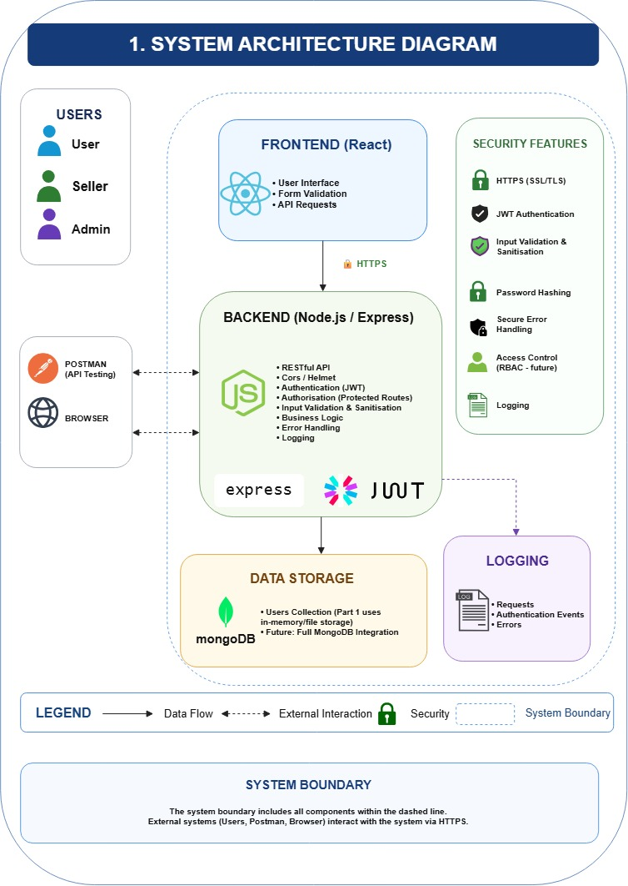

# HustleHub+ - Part 1 Submission

## Submission Details

**YouTube Video:** 
[YouTube Video Testing APIs with Postman](https://youtu.be/2G8q29dcdyQ)


## Authors

**Student Numbers:** ST10443441, ST10294763, ST10434337 
**Project:** HustleHub+

*This README* exists to walk you the marker though the systems architecture, request flow, token handling, validation approach and security rational as per Part 1's rubric.

Backend Documentation containing installation steps, environment variable placement, API reference and postman test sequence is maintained in the project Readme.md: [HustleHub+/Readme.md](HustleHub+/Readme.md)

---

## 1. Architecture Overview
HustleHub+ follows the MERN stack. Part 1 delivers the secure backend foundation the rest of the marketplace will be built on top of. 



**System boundaries**:
- The *Client* only ever communicates with the API over HTTP/HTTPS using JSON. It has no direct database access.
- The *API* owns all authentication, validation, security enforcement and business logic; and is the only component with a MongoDB connection.
- The *database* persists user records only, in this part.

**Cross-Origin Resource Sharing (CORS)** is currently scoped to `GET` and `POST` only. Later in part 2 `PUT` and `DELETE` will be used for gig management endpoints alike.

**User roles:**
- user (Client)
- seller (Freelancer)
- admin (Administrator)

Role-based access control (RBAC) restricts what each role can do, for part 1 as per instructions it only stores the roles and includes it in the JWT payload, see under Token Usage for more info.

**Persistence:**
MongoDB(via Mongoose) is the persistence layer from part 1 onwards. We choose to deliberately use it so the schema, hashing and query patters carry straight through into Part 2's gigs, bookings and transactions without unessisary rework. 

**Backend structure:**
```text
HustleHub+/
├── config/
│   └── db.js
├── controllers/
│   └── authController.js
├── middleware/
│   ├── auth.js
│   └── errorHandler.js
├── models/
│   └── User.js
├── routes/
│   └── auth.js
├── postman/
│   ├── collections/
│   ├── environments/
│   └── globals/
├── index.js
├── make-certs.js
└── package.json
```

| File | Responsibility |
|--------------------------------|-------------------------------------------------------------|
| `index.js` | Builds the Express app, wires up security middleware, connects to MongoDB, registers routes, configures HTTP/HTTPS, exposes `/health`, `/system-info`, and the 404 fallback. |
| `config/db.js` | Establishes the Mongoose connection using `DATABASE_URL`; exits the process on connection failure. |
|`controllers/authController.js`| Contains the actual registration, login and current-user handler logic validation, password/email checks, JWT issuance and error handling. |
| `models/User.js` | User schema, role enum, password-hashing pre-save hook, password comparison method. |
| `routes/auth.js` | Thin wiring only as it maps `/api/auth/register`, `/api/auth/login` and `/api/auth/me` to the controller functions |
| `middleware/auth.js` | Extracts and verifies the Bearer JWT before allowing access to a protected route. |
| `middleware/errorHandler.js` | Returns a generic error response instead of leaking internals. |
| `make-certs.js` | Generates a self-signed local dev certificate via OpenSSL (dev-only, not for production). |

---

## 2. Request Flow


**Registration**
 
```
Client
  ↓ POST /api/auth/register
Validate required fields (email, password, name, role)
  ↓ missing → 400 "All fields are required"
Validate email format and password strength
  ↓ invalid → 400 "Invalid email format" / 400 password rule message
Check whether the email already exists
  ↓ exists → 400 "Email already in use"
Hash password with bcrypt (12 salt rounds) via the User model's pre-save hook
  ↓
Store user in MongoDB
  ↓
Sign JWT
  ↓
Return 201 { token, user } — password never included
```

---
**Login**
 
```
Client
  ↓ POST /api/auth/login
Validate required fields (email, password)
  ↓ missing → 400 "Email and password are required"
Find user by email, compare via bcrypt.compare()
  ↓ no match → 401 "Invalid credentials"
Sign JWT
  ↓
Return 200 { token, user }
```

---

**Protected request**
 
```
Client
  ↓ Authorization: Bearer <JWT>
Auth middleware extracts the token
  ↓ missing → 401 "No token provided"
jwt.verify(token, JWT_SECRET)
  ↓ invalid/expired → 401 "Invalid or expired token"
Attach authenticated user ID to the request (req.userId)
  ↓
Route handler runs (e.g. GET /api/auth/me)
```

---


## 3. Token Usage

Authentication after registration/login is handled entirely with **JSON Web Tokens (JWT)**, the server never trusts a client-supplied user ID.

```js
jwt.sign(
  { userId, role },
  process.env.JWT_SECRET,
  { expiresIn: process.env.JWT_EXPIRES_IN }
);
```
- The payload only carries `userId` and `role` never the password or other sensitive data.
- `JWT_SECRET` and `JWT_EXPIRES_IN` are supplied via the `.env` environment variables file.
- Expiry limits are useful as it limits how long a stolen or leaked token may stay useful to a threat actor.
- Every protected route runs through `middleware/auth.js`, which pulls the token from the `Authorization: Bearer <token>` which verifies signature and expiry with `jwt.verify()` and rejects the request with `401 Unauthorized` if the token is missing, malformed or has expired. 
- Currently for part 1, the only protected route is `GET /api/auth/me` which returns the authenticated user's profile with the password explicitly stripped out 
    `User.findById(req.userId).select('-password')`

## 4. Validation Approach 
**Input validation:**
- *Registration* `email`, `password`, `name` and `role`. If any are missing the API returns `400` with `{ "message": "All fields are required" }`.
- *Registration* also checks the format before creating a user with regex-based email formatting check (`400 `with `{ "message": "Invalid email format" }`) & a password strength check requiring at least 8 characters with upper-case letter, lowercase letter, number and special character (`400` with a message describing the rule).
- *Duplicate email* returns `400` with `{ "message": "Email already in use" }`.
- *Login* requires `email` and `password`. If either is missing the API returns `400` with `{ "message": "Email and password are required" }`.
- *Mongoose* enforces schema-level rules: required fields, a unique & lowercased/trimmed email and an enumerated `role` of (`user`/`seller`/`admin`).

**Request-level hardening**
- *Helmet* applies Content Security Policy with these directives:
    `default-src 'self'`, 
    `script-src 'self'`, 
    `style-src 'self'`, 
    `img-src 'self' data:`, 
    `connect-src 'self' <CLIENT_ORIGIN>`, 
    `object-src 'none'`,
    `base-uri 'self'`, 
    `frame-ancestors 'none'`. 
    `crossOriginResourcePolicy` is set to `same-site`.

- **CORS** is locked to a single allowed origin via `CLIENT_ORIGIN` where it currently only permits `GET`/`POST` and the `Content-Type`/`Authorization` headers.

**Output Validation**
- `.select('-password')` guarantees that password hashes never leave the server in an API response, even accidentally.
- A successful auth responses returns a "safe" user object (`id`, `email`, `name`, `role`) and never the password or hash.

**Error handling**
- The shared `errorHandler.js` middleware returns a fixed non-descriptive `500` response with `{ "error": "Oopsie Daisy There was an error" }` rather than a stack trace, file path or config value.
- The error handler is registered after auth routes so `next(err)` calls from anywhere downstream, including future routes so it can correctly fail through it.
- Server-side console logging in `registerUser` is gated behind `NODE_ENV === 'Dev'`. This means the full error object is only printed on the server console in development, which keeps production logs free of raw error details (Stack traces, etc. ) even on the server side.
- `registerUser` also distinguishes Mongoose validation errors specifically returning: `400` with `{ "message": "Validation error" }` instead of generic `500`.
- Unknown routes return `404` with `{ "message": "Route not found" }`.


## 5. Security Rational

|Decision| Reason |
|------------------------------|-------------------------------------------------------------------------|
|Password Hashing | One way hashed passwords ensure passwords are encrypted, even in the case the database was ever compromised credentials wouldn't be immediately useable.|
|JWT for Authentication | The server verifies a signed token rather than trusting a client-asserted user ID. This prevents identity spoofing on protected routes.|
|Centralized auth middleware| Token verification lives in one place this way every protected route is covered consistently rather that implemented per route.|
|Externalized secrets `.env` | `JWT_SECRET`, `DATABASE_URL` etc. are never hard coded. This reduces the risk of secrets leaking though source control.|
|HTTPS is local dev| Credentials & JWTs are sensitive in transit. Encrypting local traffic mirrors how the app must behave in production.|
|Restricted CORS| Only the known frontend origin can call the API cross-origin, closing off obituary browser-based access.|
|Helmet + CSP | Used to reduce exposure to common browser0based attacks like XSS via script injection at the HTTP header level.|
|`X-Powered-By` is disabled | This reduces technology fingerprinting that could help the attacker target known framework vulnerabilities. | 
|Controlled error responses | Prevents internal implementation details (stack trackers, paths, secrets) from leaking to a client or threat actor. |
|Environment gated server logging | Full error details are only printed in the console in `Dev`; production server logs stay minimal reducing what's exposed even to someone with log access. |
|Email/password format validation | Regex checks on registration rejected malformed emails & weak passwords before they ever reach the database, rather than relying on Mongoose schema rules alone. 


## 6. Known Limits and Future Work for part 2 and onwards

Although rubric alludes to part 2 features in part 1 under postman testing section, per Part 1 instructions the secure backend foundation for HustleHubs full marketplace was focused on for part 1.

**Part 2:**
- [ ] React front-end
- [ ] Full Role based access control/authorization per endpoint
- [ ] Freelancer gig creation and management
- [ ] Client gig browsing and booking
- [ ] Transaction records and freelancer income tracking
- [ ] Tax estimation and financial dashboard 
- [ ] Expanded input sanitization and rate limiting
- [ ] Backend/Frontend automated testing, Newman execution

**Part 3:**
- [ ] CI/CD via Github Actions, static analysis, Docker/Compose
- [ ] Structured logging/monitoring and additional security controls


