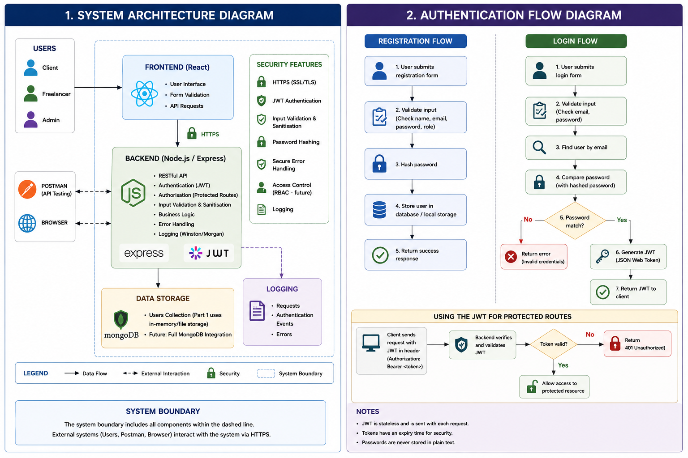

# Submission Details

**YouTube Video:** 
[Demo Video Link]()

## Authors

**Student Numbers:** ST10443441, ST10294763, ST10434337 
**Project:** HustleHub+

[Readme for the Api](HustleHub+/Readme.md)

---

# 1. Architecture Overview

fixes to make: 
- [ ] users not accurate, 
- [ ] do in-memory/file instead of mongodb...
- [ ] remove Logging (Winston/Morgan) as logging is done with console.log
Missing: (index.js)
- Helmet with a strict Content-Security-Policy (default-src 'self', object-src 'none', frame-ancestors 'none')
- CORS origin allowlist restricted to CLIENT_ORIGIN
- x-powered-by disabled (framework fingerprinting)
- generic error responses (no stack-trace leakage)
- .select('-password') so hashes never leave the server
- [ ] will just redo with draw.io **or share file on repo of diagram?**

# 2. Request Flow

# 3. Token Usage

# 4. Validation Approach 

# 5. Security Rational

# 6. Known Limits and Future Work

