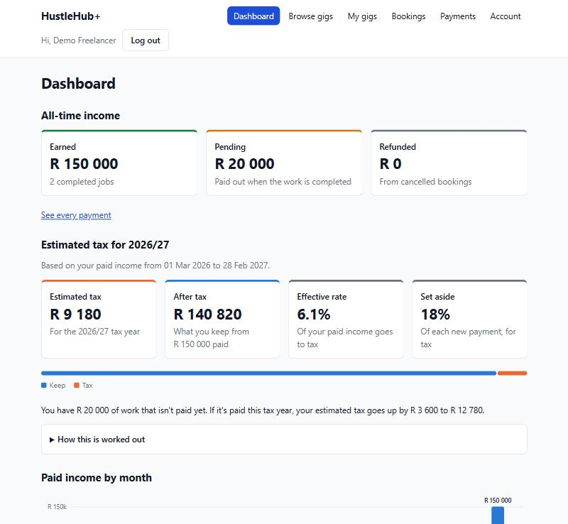
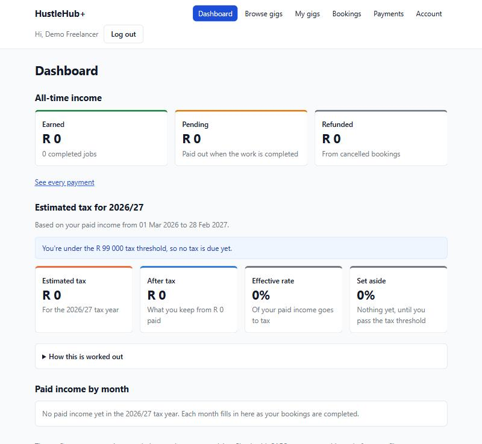

# HustleHub+ – Tax estimate for freelancers

This document explains **how the freelancer tax estimate works**, the **research** it is based on, and **why** it was built the way it is.

- The short version is in [README.md, section 7](README.md#7-tax-estimation-and-freelancer-dashboard).

---

## Contents

1. [Research: how SARS taxes a freelancer](#1-research-how-sars-taxes-a-freelancer)
2. [The 2027 tax table](#2-the-2027-tax-table)
3. [How the estimate is worked out](#3-how-the-estimate-is-worked-out)
4. [Worked examples](#4-worked-examples)
5. [Which income counts, and when](#5-which-income-counts-and-when)
6. [How the code does it](#6-how-the-code-does-it)
7. [Design decisions](#7-design-decisions)
8. [Testing](#8-testing)
9. [Security](#9-security)
10. [Updating for a new tax year](#10-updating-for-a-new-tax-year)
11. [References](#11-references)

---

## 1. Research: how SARS taxes a freelancer

A freelancer on HustleHub+ works for themselves, so they are a **sole proprietor**. In South Africa a sole proprietor is not taxed as a separate
business. They declare the business income on their own personal tax return (ITR12) and pay the tax in their personal capacity
(SARS, 2025). So they are taxed as **personal income tax**, using the same table as everyone else (SARS, 2026).

What the research found, and what it means for the app:

| Finding | What the app does |
|---|---|
| Individuals are taxed on a **sliding scale**: each part of the income is taxed at a higher rate than the part below it (SARS, 2026) | The tax is worked out band by band, not as one flat percentage |
| Everyone gets a **primary rebate** that is taken off the tax (SARS, 2026) | R17 820 is taken off after the bands are added up |
| Below the **tax threshold** no tax is due, because the rebate covers it all (SARS, 2026) | Income under R99 000 shows R0 tax and a "you're under the threshold" message |
| Older people get extra rebates and a higher threshold: R9 765 more rebate and a R153 250 threshold from 65, and another R3 249 rebate and a R171 300 threshold from 75 (SARS, 2026) | Not used. The app assumes the freelancer is under 65 |
| A tax year runs from **1 March to the end of February** (SARS, 2026) | Only payments inside the current tax year are counted |
| Anyone who earns income that isn't a salary is a **provisional taxpayer**. They pay an estimate of the year's tax in two parts: by the end of August and by the end of February (SARS, n.d.) | This is why a running estimate is useful to a freelancer: it shows what to put aside before SARS asks for it |
| Business expenses can be deducted from a sole proprietor's income, if they were spent to earn that income (SARS, 2025) | Not used. HustleHub+ doesn't record expenses, so the estimate is on the full amount paid |

The tax table was checked against the SARS website on **6 November 2026**.

---

## 2. The 2027 tax table

The **2027 tax year** runs from **1 March 2026 to 28 February 2027**. SARS names a tax year after the year it ends in.

### SARS's table (SARS, 2026)

| Taxable income (R) | Tax |
|---|---|
| 0 - 245 100 | 18% of taxable income |
| 245 101 - 383 100 | 44 118 + 26% of the amount above 245 100 |
| 383 101 - 530 200 | 79 998 + 31% of the amount above 383 100 |
| 530 201 - 695 800 | 125 599 + 36% of the amount above 530 200 |
| 695 801 - 887 000 | 185 215 + 39% of the amount above 695 800 |
| 887 001 - 1 878 600 | 259 783 + 41% of the amount above 887 000 |
| 1 878 601 and above | 666 339 + 45% of the amount above 1 878 600 |

| Rebate and threshold (under 65) | Amount |
|---|---|
| Primary rebate | **R17 820** |
| Tax threshold | **R99 000** |

### The same table as bands

SARS prints a **base amount** for each row (44 118, 79 998 …). These are not extra rules. Each base amount is just **the tax on every band below
it, added up**. So the app only needs to store the band limits and their rates:

| Band | From (R) | Up to (R) | Size of band (R) | Rate | Tax on the full band (R) | Running total = SARS base amount (R) |
|---|---|---|---|---|---|---|
| 1 | 0 | 245 100 | 245 100 | 18% | 44 118 | **44 118** |
| 2 | 245 100 | 383 100 | 138 000 | 26% | 35 880 | **79 998** |
| 3 | 383 100 | 530 200 | 147 100 | 31% | 45 601 | **125 599** |
| 4 | 530 200 | 695 800 | 165 600 | 36% | 59 616 | **185 215** |
| 5 | 695 800 | 887 000 | 191 200 | 39% | 74 568 | **259 783** |
| 6 | 887 000 | 1 878 600 | 991 600 | 41% | 406 556 | **666 339** |
| 7 | 1 878 600 | no limit | - | 45% | - | - |

The running totals match SARS's base amounts exactly. The unit tests check this for every band, so a typing mistake in a future table is caught.

### Where the threshold comes from

The threshold is the income where 18% of it equals the rebate:

> R17 820 ÷ 18% = **R99 000**

Below R99 000, the rebate is bigger than the tax, so the tax is R0. The unit tests check this too, for every table.

---

## 3. How the estimate is worked out

The API works out the estimate in these steps:

1. **Split the paid income into bands.** Each part is taxed at its band's rate.
2. **Add the parts together.** This is the **tax before rebate**.
3. **Take off the primary rebate** (R17 820). If the answer is below 0, the tax is R0.
4. **Round the tax** to the nearest rand. This is the **estimated tax**.

From the estimated tax, it also works out:

| Figure (R) | Sum | What it tells the freelancer |
|---|---|---|
| **After tax** | paid income - tax | What they actually keep |
| **Effective rate** | tax ÷ paid income | The share of *all* their income that goes to tax |
| **Set aside** (marginal rate) | the rate of the highest band the income reaches (0% under the threshold) | How much of the *next* payment will go to tax |
| **If pending is paid** | the same sum on paid + pending income | How much extra tax the unpaid work will add |

**Effective rate vs marginal rate:** a freelancer on R300 000 pays 13.5% of their whole income in tax (effective), but each *new* rand they
earn is taxed at 26% (marginal). The dashboard shows both, because "set aside 26% of new payments" is the more useful advice.

---

## 4. Worked examples

### R300 000 paid, step by step

| Part of the income | Amount | Rate | Tax |
|---|---|---|---|
| Up to R245 100 | R245 100 | 18% | R44 118 |
| R245 101 – R383 100 | R54 900 | 26% | R14 274 |
| **Tax before rebate** | | | **R58 392** |
| Minus the primary rebate | | | − R17 820 |
| **Estimated tax** | | | **R40 572** |

- After tax: R300 000 − R40 572 = **R259 428**
- Effective rate: R40 572 ÷ R300 000 = **13.5%**
- Marginal rate: the income reaches band 2, so **26%**

Check with SARS's own form: 44 118 + 26% × (300 000 − 245 100) = 44 118 + 14 274 = 58 392 ✓

### More examples

These are all checked by the unit tests:

| Paid income | Tax before rebate | Estimated tax | After tax | Effective rate | Marginal rate |
|---|---|---|---|---|---|
| R0 | R0 | **R0** | R0 | 0% | 0% |
| R80 000 | R14 400 | **R0** | R80 000 | 0% | 0% |
| R99 000 | R17 820 | **R0** | R99 000 | 0% | 18% |
| R150 000 | R27 000 | **R9 180** | R140 820 | 6.1% | 18% |
| R245 100 | R44 118 | **R26 298** | R218 802 | 10.7% | 18% |
| R300 000 | R58 392 | **R40 572** | R259 428 | 13.5% | 26% |
| R2 000 000 | R720 969 | **R703 149** | R1 296 851 | 35.2% | 45% |

### Pending work

A freelancer with **R150 000 paid** and **R20 000 pending**:

- Tax on R150 000 = **R9 180**
- Tax on R170 000 = 18% × 170 000 − 17 820 = **R12 780**
- So the pending work would add **R3 600** of tax

This is the example in the dashboard screenshot below. It was made by completing two R75 000 bookings and leaving one R20 000 booking pending.



---

## 5. Which income counts, and when

| Question | Answer | Why |
|---|---|---|
| Which payments count? | Only transactions with status **`completed`** | Pending money isn't earned yet. Refunded money was never earned. |
| Which date is used? | The completed transaction's **`updatedAt`** | A transaction is only changed once, when it leaves pending. So `updatedAt` is the day it was paid. |
| Which tax year? | The one **today** falls in | The dashboard shows the current year's running estimate |
| Which time zone? | **South African time** (`Africa/Johannesburg`, UTC+2) | A payment at 23:30 on 28 February in South Africa is 21:30 UTC. It must count in the old tax year, and it does. |

---

## 6. How the code does it

The tax is worked out **in the API**, not in the browser. The frontend only shows the result.

```
Browser (DashboardPage)
   │  GET /api/transactions/tax   (JWT, freelancers only, rate limited)
   ▼
routes/transactions.js ──► controllers/transactionController.js
   ▼
services/incomeService.js     getFreelancerTaxSummary()   ← talks to MongoDB
   │  1. getTaxYear(today)                      which tax year?
   │  2. paid income per month, pending total   two aggregations
   │  3. getTaxTable(year)                      which SARS table?
   ▼
services/taxService.js        buildTaxSummary()            ← no database, unit tested
   │  calculateTax(paid)              the estimate
   │  calculateTax(paid + pending)    the "if pending is paid" figure
   │  taxYearMonthsSoFar()            March … this month, 0 for empty months
   ▼
JSON back to the browser
```

### The tax table – `api/config/taxTables.js`

Each tax year is one entry. A band only needs its upper limit and its rate:

```js
const TAX_TABLES = {
    2027: {
        bands: [
            { upTo: 245100, percent: 18 },
            { upTo: 383100, percent: 26 },
            // ...
            { upTo: null, percent: 45 },   // the last band has no upper limit
        ],
        primaryRebate: 17820,
        threshold: 99000,
    },
};
```

- The tables are **frozen** with `Object.freeze`, so no code can change the tax figures while the app runs (MDN Web Docs, n.d.a).
- `getTaxTable(year)` returns the table for a tax year. If a new tax year has no table yet, it steps back one year at a time and uses the latest
  older one. SARS often keeps the same figures from one year to the next, so this is a safe fallback, and the dashboard says when it happens.

### The tax sum – `calculateTax(income, table)`

This is the band-by-band sum from [section 3](#3-how-the-estimate-is-worked-out):

```js
for (const band of table.bands) {
    if (income <= from) break;                    // The income doesn't reach this band

    const top = band.upTo ?? Infinity;            // The last band has no upper limit
    const amount = Math.min(income, top) - from;  // The part of the income inside this band
    const bandTaxCents = amount * band.percent;

    bands.push({ from, to: band.upTo, rate: band.percent / 100, amount, tax: centsToRand(bandTaxCents) });
    taxCents += bandTaxCents;
    from = top;
}

const taxAfterRebateCents = Math.max(0, taxCents - table.primaryRebate * 100);
const tax = Math.round(centsToRand(taxAfterRebateCents));
```

- Each band's working is kept in `bands`, so the dashboard can show the freelancer the same table as in [section 4](#4-worked-examples).
- It refuses income that isn't a whole number of rand, 0 or more, so bad data can't give a wrong answer quietly.

**Why cents?** JavaScript numbers can't store most decimals exactly (MDN Web Docs, n.d.d). For example:

| Sum | Done with decimals | Done in cents |
|---|---|---|
| 18% of R5 | `5 * 0.18` = 0.8999999999999999 | `5 * 18` = 90 cents = R0.90 |
| 26% of R11 | `11 * 0.26` = 2.8600000000000003 | `11 * 26` = 286 cents = R2.86 |

Rand × percent is always a whole number of cents, so the sum is exact. Only the final tax is rounded, once, at the end.

### The tax year – `getTaxYear(date)`

```js
// Read the year and month as they are in South Africa, e.g. "2026-11-06" -> 2026 and 11
const [year, month] = saDate(date).split('-').map(Number);
// March onwards belongs to the tax year that started this calendar year
const startYear = month >= 3 ? year : year - 1;

const start = taxYearStart(startYear);       // 1 March 00:00, South African time
const end = taxYearStart(startYear + 1);     // the next 1 March (not included)
```

- `saDate` reads the date in South African time using the `Africa/Johannesburg` time zone (MDN Web Docs, n.d.c).
- `taxYearStart` builds the date as `2026-03-01T00:00:00+02:00`, so the year starts at midnight in South Africa, not in UTC (MDN Web Docs, n.d.b).
- The year ends **just before the next 1 March**, so a leap year's 29 February is included without a special case.

### The database query – `getFreelancerTaxSummary()`

Two MongoDB aggregations run at the same time (MongoDB, n.d.a):

1. **Paid income per month:** this freelancer's `completed` transactions with `updatedAt` inside the tax year, grouped by month. The month is read
   in South African time with `$dateToString` and `timezone: 'Africa/Johannesburg'` (MongoDB, n.d.b).
2. **Pending total:** this freelancer's `pending` transactions, added up.

The results are passed to `buildTaxSummary`, which fills in months with no payments as R0 and runs `calculateTax` twice.

### What the API sends back

`GET /api/transactions/tax`, for a freelancer with R150 000 paid and R20 000 pending:

```json
{
  "currency": "ZAR",
  "taxYear": { "year": 2027, "label": "2026/27", "start": "2026-03-01", "end": "2027-02-28", "tableYear": 2027 },
  "earned": 150000,
  "pending": 20000,
  "estimate": {
    "taxableIncome": 150000,
    "taxBeforeRebate": 27000,
    "rebate": 17820,
    "threshold": 99000,
    "tax": 9180,
    "afterTax": 140820,
    "effectiveRate": 0.0612,
    "marginalRate": 0.18,
    "bands": [{ "from": 0, "to": 245100, "rate": 0.18, "amount": 150000, "tax": 27000 }]
  },
  "ifPendingPaid": { "taxableIncome": 170000, "tax": 12780, "extraTax": 3600 },
  "monthly": [
    { "month": "2026-03", "label": "Mar", "earned": 0, "count": 0 },
    { "month": "2026-11", "label": "Nov", "earned": 150000, "count": 2 }
  ]
}
```

(`monthly` is shortened here. It lists every month from March up to this month.)

### The dashboard – `app/src/pages/DashboardPage.jsx`

| Part | Component | What it shows |
|---|---|---|
| All-time income | `IncomeSummary` | Earned, pending and refunded totals |
| Estimated tax | `TaxSummary` | Estimated tax, after tax, effective rate and set aside |
| Keep vs tax | `TaxSplitBar` | One bar split into what the freelancer keeps (blue) and the tax (orange) |
| Pending note | `DashboardPage` | How much tax the pending work would add |
| How this is worked out | `TaxWorking` | The band table, the rebate, the assumptions and a link to SARS |
| Paid income by month | `MonthlyIncomeChart` | A column chart from March to this month, with a "Show as a table" view |

Before any paid work, everything is R0 and the dashboard says the freelancer is under the threshold:



---

## 7. Design decisions

| Decision | Other option | Why this one |
|---|---|---|
| Work out the tax **in the API** | Work it out in the browser | One place to test, and the browser can't change the numbers |
| A **new** endpoint, `/api/transactions/tax` | Add tax to `/income` | `/income`, its Postman tests and the Transactions page keep working as they are |
| Count only **paid** income | Count paid + pending | Tax is on money received. Pending is shown separately as "if it's paid" |
| Use **`updatedAt`** as the paid date | Add a new `paidAt` field | A completed transaction is never changed again, so no schema change is needed |
| Store **bands**, not SARS's base amounts | Copy the base amounts too | Less to type each year. The tests prove the bands give SARS's base amounts |
| Work in **cents** | Work in rand with decimals | No floating-point errors (see [section 6](#the-tax-sum--calculatetaxincome-table)) |
| Keep the sum in **`taxService.js`**, apart from the database code | Do it all in `incomeService.js` | The sum can be unit tested without a database |
| **Node's built-in test runner** (`node:test`) | Jest | Jest added 18 new `npm audit` warnings. `node:test` needs no new packages (Node.js, n.d.) |
| **Hand-made SVG** charts | A chart library | No new package to scan or patch, and sizes are SVG attributes, so the strict CSP (`style-src 'self'`) stays (OWASP Foundation, n.d.) |
| A new **Dashboard** page | Add it to the Transactions page | The brief asks for a freelancer dashboard, so it's easy for the marker to find |

---

## 8. Testing

| Test | Where | Result |
|---|---|---|
| Tax sum, tax year and summary unit tests | `api/tests/unit/` – `npm run test:unit` | 37 pass |
| Endpoint tests: freelancer 200, client 403, no token 401 | `api/tests/collection.json` – Newman | 40 requests, 82 assertions, 0 failed |
| Dashboard and component tests | `app/src/` – `npm test` | 90 pass |
| Click-through on a real local API | Two R75 000 bookings paid, one R20 000 pending | R150 000 earned, R9 180 tax, 6.1%, "+R3 600" |

What the unit tests check:

- **Every worked example** in [section 4](#4-worked-examples).
- **SARS's base amounts:** the tax at the top of each band matches the table (44 118, 79 998, 125 599, 185 215, 259 783, 666 339).
- **The threshold:** 18% of R99 000 equals the R17 820 rebate.
- **Cents:** 18% of R99 001 is R17 820.18 before the rebate, and the tax is rounded only at the end.
- **Bad input:** negative numbers, decimals, text, `NaN` and `Infinity` are refused.
- **Tax year edges:** 23:59 on 28 February is the old year and 00:00 on 1 March is the new one (South African time), and 29 February in a leap year is included.
- **Months:** only March on 1 March, all 12 months by February, and R0 for months with no payments.
- **Table fallback:** the 2028 tax year uses the 2027 table until a new one is added.

The Newman test also checks that the **paid income on the tax endpoint matches `/income`**, so the two endpoints can't disagree.

---

## 9. Security

| Risk | How it is handled |
|---|---|
| Reading someone else's income | Only freelancers can call the endpoint (`allowRoles`). The user comes from their JWT, never from the URL. |
| Injection | The endpoint takes no input at all |
| Changing the numbers in the browser | The tax is worked out on the server |
| Calling the aggregation over and over | Its own rate limit: 60 requests per 15 minutes |
| Leaking error details | Errors go through the central error handler, so no stack traces are sent |
| Changing the tax table at runtime | The tables are frozen |
| Breaking the Content Security Policy | The charts use SVG attributes and CSS classes, no inline styles |

---

## 10. Updating for a new tax year

1. When SARS publishes the new rates (usually with the February budget), add a new entry to `TAX_TABLES` in `api/config/taxTables.js`, named after
   the year the tax year ends in (for example `2028`).
2. Add the new worked examples and SARS base amounts to `api/tests/unit/taxService.test.js`.
3. Run `npm run test:unit` in `api/`. The table tests check the new entry's order, rates and threshold for you.

Until the new table is added, the latest older table is used, and the dashboard tells the freelancer that last year's figures are being used.

---

## 11. References

MDN Web Docs. n.d.a. *Object.freeze()*. [online]. Available at: https://developer.mozilla.org/en-US/docs/Web/JavaScript/Reference/Global_Objects/Object/freeze. [Accessed 7 November 2026].

MDN Web Docs. n.d.b. *Date() constructor*. [online]. Available at: https://developer.mozilla.org/en-US/docs/Web/JavaScript/Reference/Global_Objects/Date/Date. [Accessed 7 November 2026].

MDN Web Docs. n.d.c. *Date.prototype.toLocaleDateString()*. [online]. Available at: https://developer.mozilla.org/en-US/docs/Web/JavaScript/Reference/Global_Objects/Date/toLocaleDateString. [Accessed 7 November 2026].

MDN Web Docs. n.d.d. *Number*. [online]. Available at: https://developer.mozilla.org/en-US/docs/Web/JavaScript/Reference/Global_Objects/Number. [Accessed 7 November 2026].

MongoDB. n.d.a. *$group (aggregation stage)*. [online]. Available at: https://www.mongodb.com/docs/manual/reference/operator/aggregation/group/. [Accessed 9 October 2026].

MongoDB. n.d.b. *$dateToString (aggregation operator)*. [online]. Available at: https://www.mongodb.com/docs/manual/reference/operator/aggregation/dateToString/. [Accessed 6 November 2026].

Node.js. n.d. *Test runner*. [online]. Available at: https://nodejs.org/api/test.html. [Accessed 6 November 2026].

OWASP Foundation. n.d. *Content Security Policy Cheat Sheet*. [online]. Available at: https://cheatsheetseries.owasp.org/cheatsheets/Content_Security_Policy_Cheat_Sheet.html. [Accessed 6 November 2026].

South African Revenue Service (SARS). 2025. *Tax Guide for Small Businesses 2025/2026*. [online]. Available at: https://www.sars.gov.za/wp-content/uploads/Ops/Guides/Legal-Pub-Guide-Gen09-Tax-Guide-for-Small-Businesses.pdf. [Accessed 7 November 2026].

South African Revenue Service (SARS). 2026. *Rates of tax for individuals*. [online]. Available at: https://www.sars.gov.za/tax-rates/income-tax/rates-of-tax-for-individuals/. [Accessed 6 November 2026].

South African Revenue Service (SARS). n.d. *Provisional tax*. [online]. Available at: https://www.sars.gov.za/types-of-tax/provisional-tax/. [Accessed 7 November 2026].

The Independent Institute of Education (IIE). 2026. *Information Systems 3D (INSY7314/w): Portfolio of evidence*. The Independent Institute of Education (Pty) Ltd.
